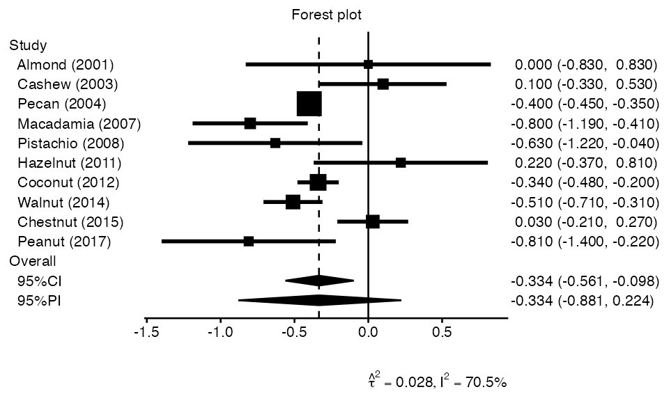
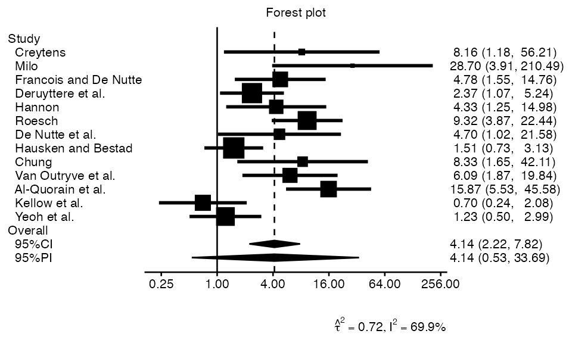

# Introduction to the \`pimeta\` package

The `pimeta` package is easy. Load your data and then pass it the `pima`
function!

\
[`library`](https://rdrr.io/r/base/library.html)`(``"pimeta"``)`\
[`library`](https://rdrr.io/r/base/library.html)`(`[`"ggplot2"`](https://ggplot2.tidyverse.org)`)`\
[`data`](https://rdrr.io/r/utils/data.html)`(``sbp``, package ``=`` ``"pimeta"``)`\
\
`# a parametric bootstrap prediction interval`\
`piboot`` ``<-`` `[`pima`](https://nshi-stat.github.io/pimeta/reference/pima.md)`(`\
`  y        ``=`` ``sbp``$``y``,      ``# effect size estimates`\
`  se       ``=`` ``sbp``$``sigmak``, ``# within studies standard errors`\
`  B        ``=`` ``25000``,      ``# number of bootstrap samples`\
`  seed     ``=`` ``14142135``,   ``# random number seed`\
`  parallel ``=`` ``4``           ``# multi-threading     `\
`)`\
`piboot`

    ## 
    ## Prediction & Confidence Intervals for Random-Effects Meta-Analysis
    ## 
    ## A parametric bootstrap prediction and confidence intervals
    ##  Heterogeneity variance: DerSimonian-Laird
    ##  Variance for average treatment effect: Hartung (Hartung-Knapp)
    ## 
    ## No. of studies: 10
    ## 
    ## Average treatment effect [95% prediction interval]:
    ##  -0.3341 [-0.8806, 0.2239]
    ##  d.f.: 9
    ## 
    ## Average treatment effect [95% confidence interval]:
    ##  -0.3341 [-0.5612, -0.0985]
    ##  d.f.: 9
    ## 
    ## Heterogeneity measure
    ##  tau-squared: 0.0282
    ##  I-squared:  70.5%

\
[`plot`](https://rdrr.io/r/graphics/plot.default.html)`(``piboot``, base_size ``=`` ``10``, studylabel ``=`` ``sbp``$``label``)`

Several type of methods (`"HTS"`, `"HK"`, `"SJ"`, …) are supported.

\
`# Higgins-Thompson-Spiegelhalter prediction interval`\
[`pima`](https://nshi-stat.github.io/pimeta/reference/pima.md)`(``sbp``$``y``, ``sbp``$``sigmak``, method ``=`` ``"HTS"``)`

    ## 
    ## Prediction & Confidence Intervals for Random-Effects Meta-Analysis
    ## 
    ## Higgins-Thompson-Spiegelhalter prediction and confidence intervals
    ##  Heterogeneity variance: DerSimonian-Laird
    ##  Variance for average treatment effect: approximate
    ## 
    ## No. of studies: 10
    ## 
    ## Average treatment effect [95% prediction interval]:
    ##  -0.3341 [-0.7598, 0.0917]
    ##  d.f.: 8
    ## 
    ## Average treatment effect [95% confidence interval]:
    ##  -0.3341 [-0.5068, -0.1613]
    ##  d.f.: 9
    ## 
    ## Heterogeneity measure
    ##  tau-squared: 0.0282
    ##  I-squared:  70.5%

The
[`convert_bin()`](https://nshi-stat.github.io/pimeta/reference/convert_bin.md)
function converts binary outcome data to effect size estimates and
within studies standard errors vectors. A data set of 13
placebo-controlled trials with cisapride that was reported by Hartung
and Knapp (Stat Med., 2001,
[doi:10.1002/sim.1009](https://doi.org/10.1002/sim.1009)) was analyzed
below. Estimated values on the logarithmic scale can be back-transformed
to the original scale with the `trans` option (in `print` and `plot`).

\
`m1`` ``<-`` `[`c`](https://rdrr.io/r/base/c.html)`(``15``,``12``,``29``,``42``,``14``,``44``,``14``,``29``,``10``,``17``,``38``,``19``,``21``)`\
`n1`` ``<-`` `[`c`](https://rdrr.io/r/base/c.html)`(``16``,``16``,``34``,``56``,``22``,``54``,``17``,``58``,``14``,``26``,``44``,``29``,``38``)`\
`m2`` ``<-`` `[`c`](https://rdrr.io/r/base/c.html)`(`` ``9``, ``1``,``18``,``31``, ``6``,``17``, ``7``,``23``, ``3``, ``6``,``12``,``22``,``19``)`\
`n2`` ``<-`` `[`c`](https://rdrr.io/r/base/c.html)`(``16``,``16``,``34``,``56``,``22``,``55``,``15``,``58``,``15``,``27``,``45``,``30``,``38``)`\
`dat`` ``<-`` `[`convert_bin`](https://nshi-stat.github.io/pimeta/reference/convert_bin.md)`(``m1``, ``n1``, ``m2``, ``n2``, type ``=`` ``"logOR"``)`\
[`head`](https://rdrr.io/r/utils/head.html)`(``dat``, n ``=`` ``3``)`

    ##          y        se
    ## 1 2.098986 0.9847737
    ## 2 3.357026 1.0165653
    ## 3 1.565232 0.5747840

\
`pibin`` ``<-`` `[`pima`](https://nshi-stat.github.io/pimeta/reference/pima.md)`(``dat``$``y``, ``dat``$``se``, seed ``=`` ``2236067``, parallel ``=`` ``4``)`\
[`print`](https://rdrr.io/r/base/print.html)`(``pibin``, digits ``=`` ``3``, trans ``=`` ``"exp"``)`

    ## 
    ## Prediction & Confidence Intervals for Random-Effects Meta-Analysis
    ## 
    ## A parametric bootstrap prediction and confidence intervals
    ##  Heterogeneity variance: DerSimonian-Laird
    ##  Variance for average treatment effect: Hartung (Hartung-Knapp)
    ## 
    ## No. of studies: 13
    ## 
    ## Average treatment effect [95% prediction interval]:
    ##  4.141 [0.533, 33.692]
    ##  d.f.: 12
    ##  Scale: exponential transformed
    ## 
    ## Average treatment effect [95% confidence interval]:
    ##  4.141 [2.224, 7.820]
    ##  d.f.: 12
    ##  Scale: exponential transformed
    ## 
    ## Heterogeneity measure
    ##  tau-squared: 0.718
    ##  I-squared:  69.9%

\
`binlabel`` ``<-`` `[`c`](https://rdrr.io/r/base/c.html)`(`\
`   ``"Creytens"``, ``"Milo"``, ``"Francois and De Nutte"``, ``"Deruyttere et al."``,`\
`   ``"Hannon"``, ``"Roesch"``, ``"De Nutte et al."``, ``"Hausken and Bestad"``,`\
`   ``"Chung"``, ``"Van Outryve et al."``, ``"Al-Quorain et al."``, ``"Kellow et al."``,`\
`   ``"Yeoh et al."``)`\
[`plot`](https://rdrr.io/r/graphics/plot.default.html)`(``pibin``, digits ``=`` ``2``, base_size ``=`` ``10``, studylabel ``=`` ``binlabel``, trans ``=`` ``"exp"``)`

Save a plot to PNG:

\
[`png`](https://rdrr.io/r/grDevices/png.html)`(``"forestplot.png"``, width ``=`` ``500``, height ``=`` ``300``, family ``=`` ``"Arial"``)`\
[`plot`](https://rdrr.io/r/graphics/plot.default.html)`(``piboot``, digits ``=`` ``2``, base_size ``=`` ``18``, studylabel ``=`` ``sbp``$``label``)`\
[`dev.off`](https://rdrr.io/r/grDevices/dev.html)`(``)`

or

\
`p`` ``<-`` `[`plot`](https://rdrr.io/r/graphics/plot.default.html)`(``piboot``, digits ``=`` ``2``, base_size ``=`` ``10``, studylabel ``=`` ``sbp``$``label``)`\
[`ggsave`](https://ggplot2.tidyverse.org/reference/ggsave.html)`(``"forestplot.png"``, ``p``, width ``=`` ``5``, height ``=`` ``3``, dpi ``=`` ``150``)`
